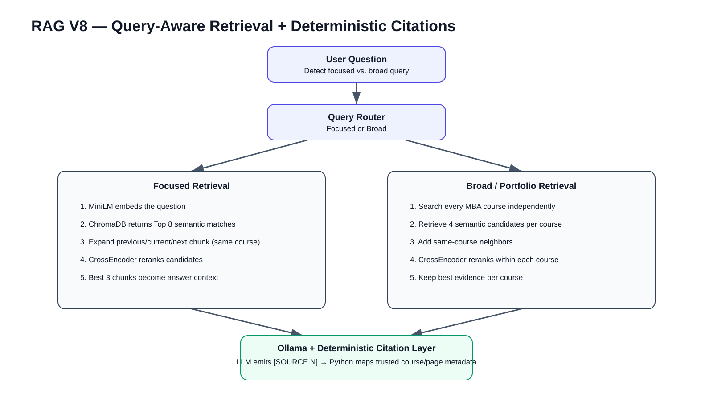

# RAG From Scratch — MBA RAG V8

This branch contains **RAG V8: Query-Aware Retrieval + Deterministic Citations**.

## Branch

```text
feature/mba-rag-v8-query-aware-retrieval
```

## What V8 adds

V8 fixes two issues discovered while testing the Streamlit RAG application:

1. **Broad portfolio questions** need wider, course-aware retrieval instead of only global Top-K retrieval.
2. **Citations must come from trusted metadata**, not from the LLM.

## Architecture



## Pipeline

### Focused questions

```text
Question
→ MiniLM embedding
→ ChromaDB Top 8
→ same-course neighbor expansion ±1
→ CrossEncoder reranking
→ best 3
→ Ollama
→ deterministic citations
```

### Broad questions

```text
Question
→ query router
→ search each of the 6 courses independently
→ neighbor expansion
→ CrossEncoder reranking
→ best evidence from each course
→ Ollama
→ deterministic citations
```

## Models

- Embeddings: `sentence-transformers/all-MiniLM-L6-v2`
- Reranker: `cross-encoder/ms-marco-MiniLM-L6-v2`
- Generation: Ollama `qwen3:4b-instruct`

## Chunking

```text
chunk_size = 800
chunk_overlap = 120
semantic Top-K = 8
neighbor range = ±1
focused final context = 3
broad candidates per course = 4
broad final per course = 2
```

## Local validation

Observed local regression result:

```text
Tests passed: 9/9
Accuracy: 100.0%
V8 LOCAL TEST: PASS
```

Full proof: [docs/results/v8-validation.md](docs/results/v8-validation.md)

Run the regression evaluation:

```powershell
uv run python src/rag_v8_evaluation.py
```

Run Streamlit:

```powershell
uv run streamlit run src/streamlit_app.py
```

## Important citation design

The LLM is instructed to use neutral source markers such as:

```text
[SOURCE 1]
```

Python converts those markers into the course and PDF page stored in retrieval metadata. This prevents the model from inventing a mismatched course/page citation.

## Source document

The MBA portfolio PDF is expected at:

```text
data/text_files/pdf/WGU_MBA_IT_Management_Bound_Edition_Biography_At_Beginning.pdf
```

The source PDF is private, kept local, and intentionally excluded from GitHub by `.gitignore`.
