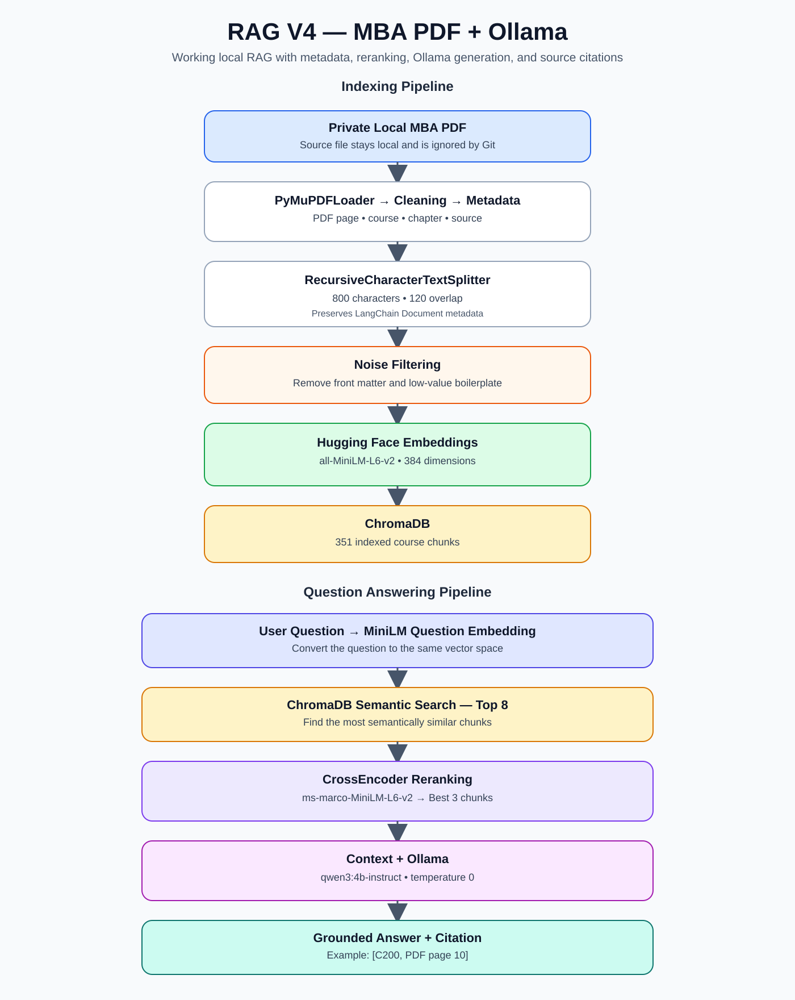

# RAG From Scratch — Working MBA RAG Branch

This branch contains the current working end-to-end RAG pipeline built during the learning project.

It uses a private local MBA portfolio PDF as the knowledge source, but **the PDF is intentionally not stored in this repository**.

## Branch

```text
feature/mba-rag-v4-ollama
```

## Architecture Diagram



## Validation Proof

The observed successful V4 run is saved in [`docs/results/v4-validation.md`](docs/results/v4-validation.md). It includes the indexing counts, model configuration, retrieved evidence, Ollama answer, and citation.

## Engineering Challenges, Decisions, and Why This Diagram

### Challenge 1 — Move from a small TXT knowledge base to a 143-page PDF

The MBA portfolio is much larger and more structured than the original Azure/AWS training text. It contains front matter, course boundaries, repeated headers, page numbers, legal/copyright text, and six different course sections.

**Decision:** add a PDF-specific ingestion layer:

```text
PyMuPDFLoader
→ text cleaning
→ course/chapter/page metadata
→ recursive chunking
```

**Why:** page and course metadata are needed later for reliable citations, while cleaning reduces retrieval noise.

### Challenge 2 — Semantic similarity alone returned noisy chunks

The first retrieval test for:

```text
What are my five CliftonStrengths?
```

found the correct answer, but a CliftonStrengths cover page and a copyright/trademark chunk also ranked highly because they contained similar words.

**Decision:** make two changes:

1. remove clearly low-value boilerplate before embedding;
2. retrieve eight semantic candidates and use a CrossEncoder to rerank them to the best three.

**Why:** the embedding model is good at broad semantic similarity, but the CrossEncoder is better at deciding which candidate actually answers the question.

### Challenge 3 — Local answer generation needed better quality

A small Hugging Face generator was useful for learning, but the MBA portfolio needed a stronger local instruction model.

**Decision:** use Ollama with:

```python
ChatOllama(
    model="qwen3:4b-instruct",
    temperature=0
)
```

**Why:** Ollama keeps generation local while Qwen3 provides stronger grounded answers. `temperature=0` makes the response more deterministic for evaluation.

### Challenge 4 — Answers needed traceable sources

A correct answer is more useful when the user can verify where it came from.

**Decision:** include course, chapter, and PDF-page metadata in retrieved context and instruct Ollama to cite the source as:

```text
[C200, PDF page 10]
```

### Why the V4 diagram is designed this way

The V4 diagram deliberately shows the full sequence from **private PDF to cited answer**.

It highlights four design boundaries:

- **document preparation** happens before retrieval;
- **embeddings and ChromaDB** are responsible for search, not generation;
- **CrossEncoder reranking** sits between retrieval and the LLM because it improves evidence quality;
- **Ollama is last** because it receives only the best retrieved context and turns that evidence into a readable answer.

The diagram does not show neighbor expansion because that problem had not yet been discovered in V4. V4 represents the architecture that was actually implemented and validated at that milestone.

## Current Architecture

```text
Private Local PDF
       ↓
PyMuPDFLoader
       ↓
Text Cleaning
       ↓
Course / Chapter / Page Metadata
       ↓
RecursiveCharacterTextSplitter
800 characters / 120 overlap
       ↓
Front-Matter + Boilerplate Filtering
       ↓
Hugging Face MiniLM Embeddings
all-MiniLM-L6-v2
       ↓
ChromaDB
       ↓
User Question
       ↓
Question Embedding
       ↓
Top-8 Semantic Retrieval
       ↓
CrossEncoder Reranking
ms-marco-MiniLM-L6-v2
       ↓
Best 3 Chunks
       ↓
Context Construction
       ↓
Ollama
qwen3:4b-instruct
       ↓
Grounded Answer
       ↓
Course + PDF Page Citation
```

## Privacy

The source PDF is private and must remain local.

The repository ignores:

```text
*.pdf
data/text_files/pdf/
chroma_db_*/
```

Do not commit personal PDFs or local ChromaDB files.

## Local PDF Location

Create this folder locally:

```text
data/
└── text_files/
    └── pdf/
```

Place the private PDF there using this filename:

```text
WGU_MBA_IT_Management_Bound_Edition_Biography_At_Beginning.pdf
```

The file will remain ignored by Git.

## Models

### Embeddings

```text
sentence-transformers/all-MiniLM-L6-v2
```

384-dimensional local embeddings.

### Reranker

```text
cross-encoder/ms-marco-MiniLM-L6-v2
```

The system retrieves eight candidates from ChromaDB and reranks them to the best three.

### Answer Generation

```text
qwen3:4b-instruct
```

The generation model runs locally through Ollama.

## Setup

Install Python 3.12+ and `uv`.

```powershell
git clone https://github.com/kantinstephane10/kantinstephane10-rag-from-scratch-azure-aws.git

cd kantinstephane10-rag-from-scratch-azure-aws

git switch feature/mba-rag-v4-ollama

uv sync
```

Install Ollama separately, then pull the model:

```powershell
ollama pull qwen3:4b-instruct
```

Confirm it exists:

```powershell
ollama list
```

## Run

After placing the private PDF in the local ignored folder:

```powershell
uv run python src/rag_pipeline.py
```

The CLI will ask:

```text
Ask a question about the MBA document:
```

Example:

```text
What are my five CliftonStrengths?
```

A working answer should be grounded in the retrieved document and include a source citation such as:

```text
My five CliftonStrengths are Learner, Strategic, Belief,
Context, and Deliberative. [C200, PDF page 10]
```

## Current RAG Features

- PDF loading with PyMuPDF
- text cleaning
- recursive character chunking
- 800-character chunks
- 120-character overlap
- course/chapter/page metadata
- front-matter exclusion
- low-value boilerplate filtering
- local Hugging Face embeddings
- persistent ChromaDB vector storage
- semantic Top-K retrieval
- CrossEncoder reranking
- local Ollama generation
- grounded prompting
- course and PDF-page citations

## Next Step

The next milestone is **RAG evaluation** across all six MBA courses before adding a Streamlit interface or agent capabilities.
