# RAG From Scratch — MBA RAG V10

This branch contains **RAG V10: Persistent Conversational Memory with SQLite**.

## Branch

```text
feature/mba-rag-v10-persistent-memory
```

V10 is built on the validated V9 conversational RAG architecture.

The main change is simple but important:

> V9 remembers the conversation only while the current application session is alive.  
> V10 stores conversations in SQLite so they can be reopened and continued after the application restarts.

---

## 🎬 Animated V10 Architecture

<p align="center">
  
</p>

<p align="center">
  <strong>PDF → preprocessing → MiniLM → ChromaDB → Streamlit → SQLite memory → follow-up rewrite → focused/broad retrieval → CrossEncoder → Ollama → deterministic citations → durable conversation save</strong>
</p>

> **Interactive view:** [Open the full animated V10 architecture](docs/rag-v10-persistent-memory-architecture.svg)

---

## What V10 adds

V10 keeps the validated V9 retrieval and generation behavior and adds a persistent conversation layer.

New V10 capabilities:

- SQLite persistent memory;
- multiple independent conversations;
- conversations that survive application restart;
- previous-conversation selection;
- automatic conversation titles;
- rename conversation;
- clear conversation;
- delete conversation;
- recent-memory loading for the LLM;
- full conversation history stored on disk;
- Streamlit conversation management UI.

The validated V9 retrieval architecture remains:

- focused vs. broad query routing;
- semantic retrieval;
- neighbor expansion;
- CrossEncoder reranking;
- broad-query course relevance gate;
- Ollama generation;
- deterministic Python metadata citations;
- citation deduplication;
- grounded refusal.

---

## Why SQLite?

V10 deliberately uses Python's built-in `sqlite3` module instead of adding a larger memory framework or ORM.

This keeps the learning architecture easy to understand:

```text
Streamlit
    ↓
SQLite
    ↓
Conversation
    ↓
Messages
```

SQLite gives the application:

- local persistence;
- no external database server;
- no additional Python dependency;
- simple SQL;
- multiple conversations;
- durable chat history;
- easy transition toward a larger database later.

---

## V9 vs. V10

### V9

```text
Streamlit session_state
        ↓
Conversation history
        ↓
Application stops
        ↓
Memory disappears
```

### V10

```text
Streamlit
    ↓
SQLite conversation database
    ↓
Application stops
    ↓
SQLite remains on disk
    ↓
Application restarts
    ↓
Previous conversations return
    ↓
Continue the conversation
```

---

## Persistent-memory design

SQLite contains two main tables:

```text
conversations
      │
      └──────── messages
```

### conversations

Stores:

- conversation ID;
- title;
- created timestamp;
- updated timestamp.

### messages

Stores:

- conversation ID;
- role;
- message content;
- query type;
- standalone rewritten question;
- retrieved sources as JSON;
- timestamp.

This means V10 persists not only the visible chat text, but also the retrieval metadata needed to restore the full Streamlit conversation experience.

---

## Memory window

SQLite stores the complete conversation.

The LLM receives only the most recent:

```text
12 messages
```

This keeps two concerns separate:

```text
Persistent storage
    = complete conversation history

LLM memory window
    = recent 12 messages
```

The conversation can therefore grow without sending the entire history to the model on every turn.

---

## Conversational flow

```text
User Question
      ↓
Load conversation from SQLite
      ↓
Recent 12-message memory window
      ↓
Follow-Up Question Rewriter
      ↓
Standalone Question
      ↓
Query Router
     / \
Focused  Broad
   ↓       ↓
Top 8     Search all 6 courses
   ↓       ↓
Neighbor  Neighbor
   ±1      ±1
   ↓       ↓
CrossEncoder
   ↓       ↓
Best 3    Best evidence/course
           ↓
      Relevance Gate
       \   /
        ↓
Retrieved Evidence
        ↓
Ollama
        ↓
[SOURCE N]
        ↓
Python Metadata Citations
        ↓
Final Answer
        ↓
Save user + assistant turn to SQLite
        ↓
Available after restart
```

---

## Conversation management

The V10 Streamlit sidebar supports:

```text
➕ New Conversation
↔ Select Previous Conversation
✎ Automatic Title
✎ Rename Conversation
🧹 Clear Conversation
🗑 Delete Conversation
↻ Restart and Resume
```

### New conversation

Creates an independent SQLite conversation ID.

### Automatic title

The first user question becomes the initial conversation title.

### Rename

The user can rename a conversation from the Streamlit sidebar.

During browser validation, the original Streamlit rename widget did not update correctly even though the SQLite rename function itself was passing tests.

The UI was changed to submit the title and rename action together using a Streamlit form.

The corrected rename flow was validated successfully.

### Clear

Deletes messages while preserving the conversation itself.

### Delete

Deletes the conversation and its associated messages using SQLite foreign-key cascading.

---

## Models

- Embeddings: `sentence-transformers/all-MiniLM-L6-v2`
- Reranker: `cross-encoder/ms-marco-MiniLM-L6-v2`
- Generation: Ollama `qwen3:4b-instruct`

---

## Retrieval configuration

```text
chunk_size = 800
chunk_overlap = 120

focused semantic candidates = 8
neighbor range = ±1
focused final context = 3

broad semantic candidates/course = 4
broad final chunks/course = 2

conversation memory window = 12 recent messages
persistent storage = SQLite
```

---

## Observed index

```text
Pages loaded: 143
All chunks: 366
Course chunks: 354
Final indexed chunks: 351
Embedding shape: (351, 384)
Vectors stored: 351
```

---

## Validation

### 1. V10 notebook conversation-management validation

Observed:

```text
Tests passed: 31/31
Accuracy: 100.0%
V10 CONVERSATION MANAGEMENT: PASS
```

### 2. True restart persistence

After restarting the Jupyter kernel:

```text
V10 TRUE RESTART PERSISTENCE: PASS
```

The saved CliftonStrengths conversation and its four messages were recovered directly from SQLite.

### 3. Repo-native SQLite regression

Run:

```powershell
uv run python src/rag_v10_memory_test.py
```

Observed:

```text
Tests passed: 18/18
Accuracy: 100.0%
V10 REPO MEMORY TEST: PASS
```

### 4. V9 RAG regression on the V10 branch

Run:

```powershell
uv run python src/rag_v9_evaluation.py
```

Observed:

```text
Tests passed: 12/12
Accuracy: 100.0%
V9 REGRESSION TEST: PASS
```

This confirms that adding persistent memory did not break the validated retrieval and generation behavior.

### 5. Streamlit browser validation

Validated manually:

- new conversation;
- focused question;
- memory-dependent follow-up;
- second independent conversation;
- switch between saved conversations;
- reload previous messages;
- automatic title;
- rename after UI fix;
- clear;
- delete;
- broad retrieval;
- grounded refusal;
- application stop/restart;
- restore previous conversations.

Full proof:

[docs/results/v10-validation.md](docs/results/v10-validation.md)

---

## Example persistent conversation

Initial question:

```text
What are my five CliftonStrengths?
```

Observed answer:

```text
My five CliftonStrengths are Learner, Strategic, Belief,
Context, and Deliberative [C200, PDF page 10].
```

Follow-up:

```text
Which one was ranked highest?
```

Internal standalone rewrite:

```text
Which of my five CliftonStrengths was ranked highest?
```

Observed answer:

```text
Learner was ranked highest. [C200, PDF page 10]
```

After application restart, the conversation remains available in SQLite.

---

## Example second conversation

Question:

```text
What technologies were proposed for the Agentic RAG architecture?
```

Observed answer identified:

```text
Microsoft Foundry Agent Service
Azure AI Search
```

with:

```text
[MMT2-BEN1, PDF page 115]
```

Follow-up:

```text
Which one provides the search and retrieval layer?
```

Observed answer:

```text
Azure AI Search provides the search and retrieval layer.
[MMT2-BEN1, PDF page 115]
```

---

## Broad-query regression

Question:

```text
Identify all courses in my MBA portfolio that discuss project management.
```

Observed answer:

```text
The course in your MBA portfolio that discusses project management is
MGT2-KKM1: Project Management [MGT2-KKM1, PDF page 72].
```

The previous C200 false positive remained removed.

---

## Grounded refusal

Question:

```text
What is Microsoft's current stock price?
```

Observed answer:

```text
I don't have enough information in the provided document to answer that.
```

---

## Repository structure

```text
src/
├── rag_pipeline.py
├── memory_db.py
├── streamlit_app.py
├── rag_v9_evaluation.py
└── rag_v10_memory_test.py

docs/
├── rag-v10-persistent-memory-architecture.svg
└── results/
    └── v10-validation.md

data/
├── memory/
│   └── rag_v10_memory.db        # local only, ignored by Git
└── text_files/
    └── pdf/
        └── WGU_MBA_IT_Management_Bound_Edition_Biography_At_Beginning.pdf
```

---

## Run V10

Clone or switch to:

```powershell
git switch feature/mba-rag-v10-persistent-memory
git pull origin feature/mba-rag-v10-persistent-memory
```

### Test persistent memory

```powershell
uv run python src/rag_v10_memory_test.py
```

### Run the RAG regression

```powershell
uv run python src/rag_v9_evaluation.py
```

### Run Streamlit

```powershell
uv run streamlit run src/streamlit_app.py
```

---

## SQLite data location

V10 stores local chat history at:

```text
data/memory/rag_v10_memory.db
```

The SQLite database and related WAL/SHM files are excluded from Git.

This means application code is version controlled while local conversation history stays on the machine running the application.

---

## Source document

The RAG source PDF is:

```text
data/text_files/pdf/WGU_MBA_IT_Management_Bound_Edition_Biography_At_Beginning.pdf
```

The source PDF is private, kept local, and intentionally excluded from GitHub by `.gitignore`.

---

## V10 milestone status

```text
Notebook conversation-management validation: 31/31 PASS
True restart persistence: PASS
Repo SQLite regression: 18/18 PASS
V9 RAG regression: 12/12 PASS
Streamlit browser validation: PASS
Rename browser validation after fix: PASS

RAG V10 PERSISTENT CONVERSATIONAL MEMORY: COMPLETE
```

---

## Next milestone

### V11 — Multi-Document RAG

The next milestone will evolve the system from one source document to multiple documents.

Target direction:

```text
Document 1 ─┐
Document 2 ─┤
Document 3 ─┤
Document N ─┘
     ↓
Document-aware metadata
     ↓
Chunking
     ↓
Embeddings
     ↓
Vector Database
     ↓
Question
     ↓
Search one selected document
or search across all documents
     ↓
CrossEncoder reranking
     ↓
Grounded answer with document-aware citations
```
