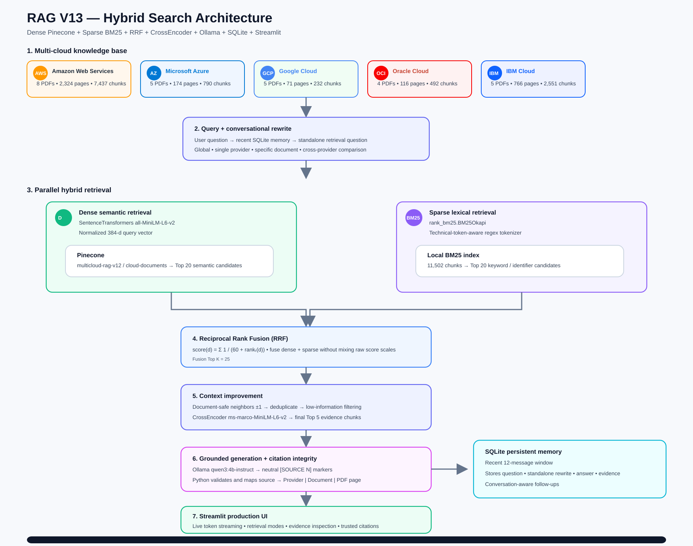

# RAG From Scratch — V13 Hybrid Search

This repository is a progressive, hands-on RAG engineering project built from first principles and evolved through validated milestones.

The current milestone is **RAG V13: Hybrid Search (Dense + Sparse)**.

> **Source status:** the exact V13 runtime files `src/rag_v13.py` and `src/streamlit_v13.py` were validated on the development workstation. The V13 architecture, milestone documentation, and validation proof are committed here; the two local runtime files still need to be committed from that workstation so GitHub matches the tested local environment exactly.

## Current V13 scope

V13 keeps the V12 multi-cloud corpus and upgrades retrieval from dense-only semantic search to a hybrid pipeline using **Pinecone + BM25 + Reciprocal Rank Fusion (RRF)**.

| Provider | PDFs | Pages | Chunks |
| --- | ---: | ---: | ---: |
| AWS | 8 | 2,324 | 7,437 |
| Azure | 5 | 174 | 790 |
| GCP | 5 | 71 | 232 |
| Oracle | 4 | 116 | 492 |
| IBM | 5 | 766 | 2,551 |
| **Total** | **27** | **3,451** | **11,502** |

The source PDFs remain local and are intentionally excluded from Git.

## V13 architecture

<p align="center">
  
</p>

```text
User query
    ↓
Conversation-aware rewrite
    ↓
┌──────────────────────────┐      ┌──────────────────────────┐
│ Dense retrieval          │      │ Sparse retrieval         │
│ MiniLM → Pinecone        │      │ BM25 lexical search      │
│ Top 20                   │      │ Top 20                   │
└──────────────────────────┘      └──────────────────────────┘
              \                    /
               \                  /
                ↓                ↓
             Reciprocal Rank Fusion
                      ↓
          Same-document neighbors ±1
                      ↓
          Deduplicate + filter noise
                      ↓
             CrossEncoder reranking
                      ↓
              Best 5 evidence chunks
                      ↓
          Ollama qwen3:4b-instruct
                      ↓
           Strict source validation
                      ↓
      Trusted provider/document/page citations
                      ↓
          SQLite memory + Streamlit
```

## Production stack

- Python 3.12+
- uv
- LangChain Community document loaders
- LangChain text splitters
- PyMuPDF
- SentenceTransformers
- `sentence-transformers/all-MiniLM-L6-v2`
- Pinecone
- `rank_bm25.BM25Okapi`
- Reciprocal Rank Fusion
- `cross-encoder/ms-marco-MiniLM-L6-v2`
- Ollama
- `qwen3:4b-instruct`
- SQLite
- Streamlit

## What V13 added

### Dense + sparse retrieval

Dense retrieval handles semantic similarity and paraphrases. BM25 adds exact lexical matching for technical terms, identifiers, service names, and codes.

Examples that benefit from BM25 include:

```text
SEC11-BP06
HTTP-502
active.htm
us-east-1
```

### Reciprocal Rank Fusion

V13 fuses the dense and sparse ranked lists with:

```text
RRF score(d) = Σ 1 / (k + rankᵣ(d))
```

with `k = 60`.

This avoids directly adding BM25 and cosine scores, which are not on the same scale.

### Retrieval configuration

```text
DENSE_TOP_K = 20
BM25_TOP_K = 20
RRF_K = 60
FUSION_TOP_K = 25
NEIGHBOR_RANGE = 1
FINAL_TOP_K = 5
MIN_EVIDENCE_CHARS = 120
```

Cross-provider comparisons use a larger provider-specific candidate pool before balancing evidence.

### Grounding and citation integrity

The LLM emits neutral markers such as:

```text
[SOURCE 2]
```

Python validates and maps them to trusted metadata:

```text
[AWS | AWS Reliability Pillar | PDF page 9]
```

V13 hardens this pipeline by rejecting malformed, negative, and out-of-range source numbers, normalizing combined source markers, and collapsing adjacent duplicate final citations.

### Persistent conversational memory

SQLite stores:

- conversations;
- user and assistant messages;
- query type;
- standalone rewritten follow-up question;
- retrieved evidence JSON.

The recent memory window is used to rewrite follow-up questions before retrieval.

### Comparison-aware global routing

Global mode can detect obvious multi-cloud comparison intent without requiring the user to manually switch modes.

Examples:

```text
Compare AWS and Azure
→ AWS + Azure balanced retrieval

What is AWS?
Compare it to Azure
→ conversation context resolves AWS + Azure

Compare different cloud services side by side
→ AWS + Azure + GCP + Oracle + IBM
```

This is a deterministic V13 routing layer, not the later V18 model-based router.

### Live Streamlit generation

The production UI streams Ollama tokens live into the browser while preserving the validated backend pipeline.

The final browser answer is replaced with the trusted citation-rendered answer after generation completes.

## V13 benchmark

A 10-query development benchmark produced:

| Retriever | Hit@1 | Hit@3 | Hit@5 | MRR |
| --- | ---: | ---: | ---: | ---: |
| Dense | 0.90 | 1.00 | 1.00 | 0.9333 |
| BM25 | 0.80 | 1.00 | 1.00 | 0.8833 |
| Hybrid | 0.90 | 1.00 | 1.00 | **0.9500** |

On this starter benchmark, Hybrid preserved Dense Hit@1 and improved MRR. This is a development result, not a universal claim.

## V13 production validation

Fresh-process backend test:

```text
Backend cache independent:             PASS
BM25 independent:                      PASS
Pinecone dense search independent:     PASS
Hybrid retrieval independent:          PASS
Cross-provider retrieval independent:  PASS

Tests passed: 5/5
V13 PRODUCTION BACKEND INDEPENDENCE: PASS
```

Fresh-process live streaming test:

```text
Callback received tokens:       PASS
Raw answer created:             PASS
Citation validation:            PASS
Trusted final citations:        PASS
SQLite persisted 2 messages:    PASS

Tests passed: 5/5
V13 PRODUCTION LIVE STREAMING: PASS
```

Browser validation confirmed:

- Global mode
- Single-provider mode
- Cross-provider mode
- live token streaming
- trusted citations
- retrieved-evidence inspection
- persistent SQLite conversation memory
- follow-up rewriting
- comparison-aware global routing
- citation hardening

Detailed proof:

- [V13 architecture and engineering notes](docs/v13-hybrid-search.md)
- [V13 validation proof](docs/results/v13-validation.md)
- [V13 architecture diagram](docs/rag-v13-hybrid-architecture.svg)

## Corpus coverage finding

The V13 provider/topic audit showed that retrieval is working, but the 27-document corpus is not evenly balanced across every provider and topic.

Examples:

- AWS: strong security/reliability coverage
- Azure: strong reliability/cloud-native coverage
- GCP: current corpus is security-heavy
- Oracle: strong IAM/networking coverage
- IBM: strong object-storage coverage

The corpus-gap plan is a backlog item and does not block the V13 hybrid-search milestone.

## Pinecone

V13 intentionally reuses the V12 dense index because the stored dense representation did not change:

```text
Index: multicloud-rag-v12
Namespace: cloud-documents
Records: 11,502
Vector field: embedding
Dimension: 384
```

BM25 is built locally over the same 11,502 chunks and fused with Pinecone results at query time.

## Security

Do not commit:

- real Pinecone API keys;
- private source PDFs;
- SQLite conversation databases;
- local vector database directories;
- trusted local cache files containing private corpus text unless explicitly intended.

The repository includes `.env.example` and `.gitignore` rules for local-only data.

## Previous milestone

V12 introduced the 27-document, five-provider corpus, document-safe chunk identity, Pinecone multi-document retrieval, CrossEncoder reranking, deterministic citations, SQLite memory, and the production Streamlit baseline.

- [V12 architecture](docs/rag-v12-multicloud-architecture.svg)
- [V12 engineering notes](docs/v12-multi-document-rag.md)
- [V12 validation proof](docs/results/v12-validation.md)

## Roadmap

```text
V13  Hybrid Search                         COMPLETE
V14  Metadata-Aware Retrieval              NEXT
V15  Advanced Chunking
V16  Query Transformation
V17  Advanced Retrieval / Reranking
V18  Model-Based Router
V19  Specialized Models / Tasks
V20  Evaluation + Observability
V21  Guardrails + Security
V22  Agentic RAG / Tool Routing
V23  Production Deployment
```

## Current milestone

**RAG V13 — HYBRID SEARCH: COMPLETE**

Next: **V14 — Metadata-Aware Retrieval**.
