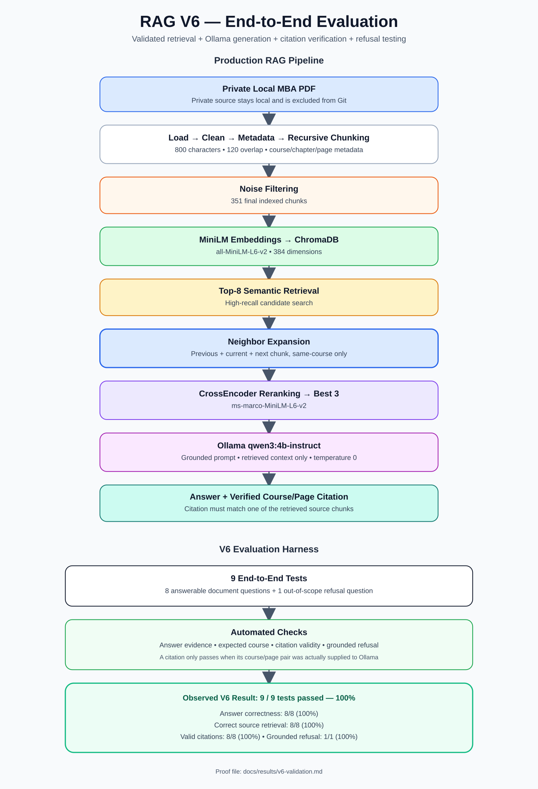

# RAG From Scratch — Working MBA RAG Branch

This branch contains the current working end-to-end RAG pipeline built during the learning project.

It uses a private local MBA portfolio PDF as the knowledge source, but **the PDF is intentionally not stored in this repository**.

## Branch

```text
feature/mba-rag-v6-end-to-end-evaluation
```

## Architecture Diagram



## Validation Proof

The observed V6 result is saved in [`docs/results/v6-validation.md`](docs/results/v6-validation.md).

```text
Total tests: 9
Total passed: 9
Answer correctness: 8/8 (100.0%)
Correct source retrieval: 8/8 (100.0%)
Valid citation accuracy: 8/8 (100.0%)
Grounded refusal accuracy: 1/1 (100.0%)
Overall end-to-end accuracy: 9/9 (100.0%)
```

Run the evaluation locally with:

```powershell
uv run python src/rag_v6_evaluation.py
```

## Engineering Challenges, Decisions, and Why This Diagram

### Challenge — perfect retrieval does not prove the RAG system is correct

V5.2 reached **100% Hit@3** on the 12-question retrieval test. That proved the right evidence was available to the generation step, but it did **not** prove that Ollama would:

- use the evidence correctly;
- include the required facts;
- cite a source it actually received;
- refuse a question that the document cannot answer.

A RAG system can have excellent retrieval and still hallucinate during generation.

### Decision — evaluate the complete pipeline separately

Instead of changing the production RAG code again, V6 adds a separate evaluation harness:

```text
src/rag_v6_evaluation.py
```

**Why:** production code and test code have different responsibilities. Keeping evaluation separate makes the working RAG pipeline easier to understand and allows repeatable regression testing.

### What V6 validates

For answerable questions, the evaluation checks:

1. **Answer evidence** — required facts must appear in the generated answer.
2. **Correct source retrieval** — the expected course must be in the retrieved Top 3.
3. **Citation validity** — a cited course/page must exactly match a source that Ollama actually received.

For an unanswerable question, the evaluation checks:

4. **Grounded refusal** — Ollama must refuse instead of answering from outside model knowledge.

### Why we included an out-of-scope question

The test:

```text
What is Microsoft's current stock price?
```

is intentionally unrelated to information available in the MBA portfolio.

Qwen may have outside knowledge, but a grounded RAG assistant should answer only from retrieved document evidence.

The required behavior is:

```text
I don't have enough information in the provided document to answer that.
```

### Result of the decision

The observed V6 evaluation produced:

```text
Total tests: 9
Total passed: 9

Answer correctness:        8/8 (100%)
Correct source retrieval:  8/8 (100%)
Valid citation accuracy:   8/8 (100%)
Grounded refusal accuracy: 1/1 (100%)

Overall: 9/9 (100%)
```

### Why the V6 diagram is designed this way

The top part of the V6 diagram preserves the validated V5.2 production pipeline because V6 did not replace the retriever.

The new lower section represents the **evaluation harness**.

This visual separation communicates an important engineering principle:

```text
Production RAG
      ↓
observable answer + sources
      ↓
independent evaluation
```

The diagram shows four checks after generation—answer correctness, source correctness, citation validation, and refusal behavior—because V6's purpose is to prove that the whole system behaves correctly, not merely that retrieval works.

The 100% result appears at the bottom as measured evidence, not as an assumed claim.

## Current Architecture

```text
Private Local PDF
       ↓
PyMuPDFLoader
       ↓
Text Cleaning
       ↓
Course / Chapter / Page Metadata
       ↓
RecursiveCharacterTextSplitter
800 characters / 120 overlap
       ↓
Front-Matter + Boilerplate Filtering
       ↓
Hugging Face MiniLM Embeddings
all-MiniLM-L6-v2
       ↓
ChromaDB
       ↓
User Question
       ↓
Question Embedding
       ↓
Top-8 Semantic Retrieval
       ↓
Neighbor Expansion (±1 chunk)
       ↓
CrossEncoder Reranking
ms-marco-MiniLM-L6-v2
       ↓
Best 3 Chunks
       ↓
Context Construction
       ↓
Ollama
qwen3:4b-instruct
       ↓
Grounded Answer
       ↓
Course + PDF Page Citation
```

## Privacy

The source PDF is private and must remain local.

The repository ignores:

```text
*.pdf
data/text_files/pdf/
chroma_db_*/
```

Do not commit personal PDFs or local ChromaDB files.

## Local PDF Location

Create this folder locally:

```text
data/
└── text_files/
    └── pdf/
```

Place the private PDF there using this filename:

```text
WGU_MBA_IT_Management_Bound_Edition_Biography_At_Beginning.pdf
```

The file will remain ignored by Git.

## Models

### Embeddings

```text
sentence-transformers/all-MiniLM-L6-v2
```

384-dimensional local embeddings.

### Reranker

```text
cross-encoder/ms-marco-MiniLM-L6-v2
```

The system retrieves eight candidates from ChromaDB and reranks them to the best three.

### Answer Generation

```text
qwen3:4b-instruct
```

The generation model runs locally through Ollama.

## Setup

Install Python 3.12+ and `uv`.

```powershell
git clone https://github.com/kantinstephane10/kantinstephane10-rag-from-scratch-azure-aws.git

cd kantinstephane10-rag-from-scratch-azure-aws

git switch feature/mba-rag-v6-end-to-end-evaluation

uv sync
```

Install Ollama separately, then pull the model:

```powershell
ollama pull qwen3:4b-instruct
```

Confirm it exists:

```powershell
ollama list
```

## Run

After placing the private PDF in the local ignored folder:

```powershell
uv run python src/rag_pipeline.py
```

The CLI will ask:

```text
Ask a question about the MBA document:
```

Example:

```text
What are my five CliftonStrengths?
```

A working answer should be grounded in the retrieved document and include a source citation such as:

```text
My five CliftonStrengths are Learner, Strategic, Belief,
Context, and Deliberative. [C200, PDF page 10]
```

## Current RAG Features

- PDF loading with PyMuPDF
- text cleaning
- recursive character chunking
- 800-character chunks
- 120-character overlap
- course/chapter/page metadata
- front-matter exclusion
- low-value boilerplate filtering
- local Hugging Face embeddings
- persistent ChromaDB vector storage
- semantic Top-K retrieval
- neighboring-chunk expansion
- CrossEncoder reranking
- local Ollama generation
- grounded prompting
- course and PDF-page citations

## Retrieval Evaluation

The V5.2 retriever was evaluated with 12 questions spanning all six MBA courses.

Results:

```text
Hit@1:  9/12  (75.0%)
Hit@3: 12/12 (100.0%)
Hit@5: 12/12 (100.0%)
Hit@8: 12/12 (100.0%)
MRR:   0.875
```

A retrieval failure involving the Agentic RAG architecture was diagnosed and fixed with neighboring-chunk expansion. The semantic search found an adjacent introductory chunk, and the answer-bearing next chunk was added before reranking.

## Next Step

V6 end-to-end evaluation is complete. The next milestone is a **Streamlit interface** built on top of the validated V5.2/V6 RAG pipeline.
