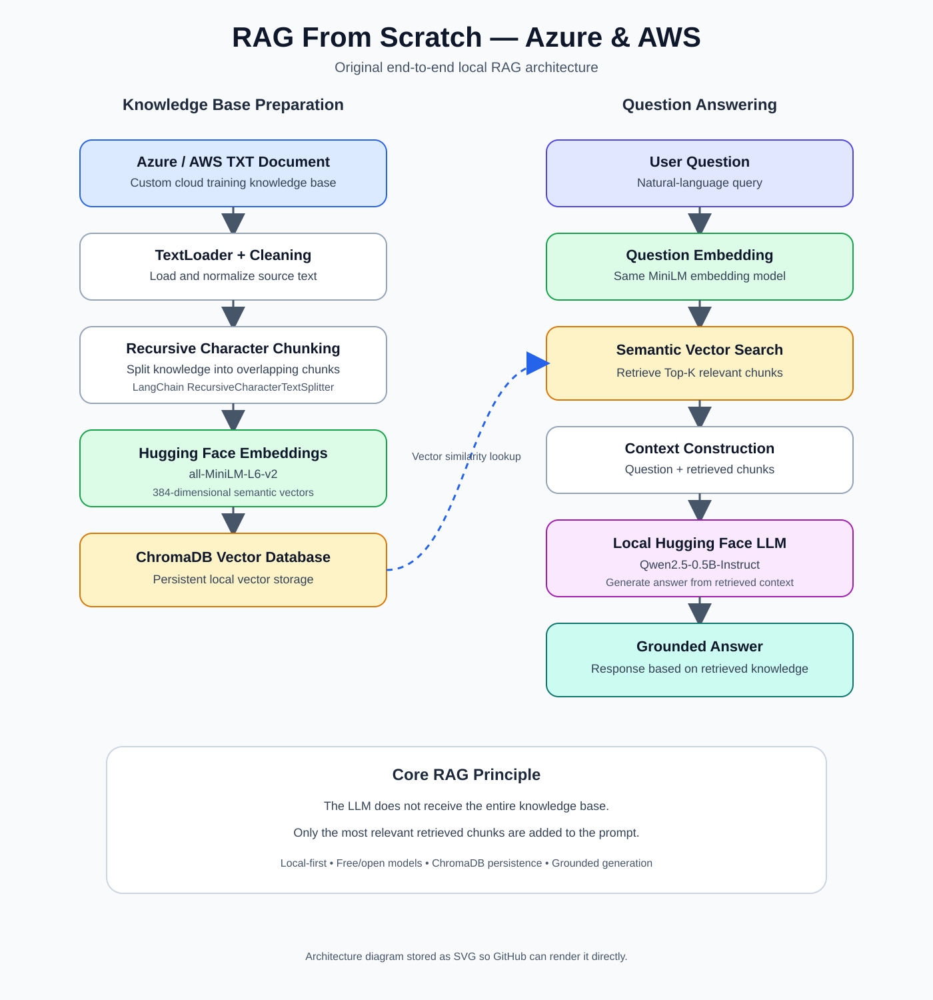

# RAG From Scratch — Azure & AWS

A hands-on Retrieval-Augmented Generation (RAG) project built from scratch with Python, LangChain document utilities, Hugging Face embeddings, ChromaDB, and a small local Hugging Face instruction model.

The project uses a custom Azure and AWS cloud knowledge base and demonstrates the complete RAG learning path from raw text to a grounded answer.

## Architecture



## Validation Proof

The observed working result for this version is saved in [`docs/results/original-rag-validation.md`](docs/results/original-rag-validation.md).


## Engineering Challenges, Decisions, and Why This Diagram

### Challenge 1 — Learn RAG from first principles without hiding the workflow

The first goal was not to use a large prebuilt chain. The goal was to understand each RAG stage separately: loading, cleaning, chunking, embedding, vector search, context construction, and generation.

**Decision:** keep the first implementation intentionally simple and local. Each stage is visible in the code and can be tested independently.

**Why:** this makes failures easier to understand. If the final answer is wrong, we can inspect whether the problem came from chunking, retrieval, context, or generation instead of treating RAG as one black box.

### Challenge 2 — Run locally without depending on a paid API

The project needed a free/local stack that could run on a Windows development machine.

**Decision:** use:

- `all-MiniLM-L6-v2` for lightweight 384-dimensional embeddings;
- ChromaDB for a simple persistent local vector database;
- a small Qwen instruction model for local generation.

**Why:** these choices kept the system accessible while still demonstrating a complete RAG workflow.

### Challenge 3 — Separate indexing from question answering

A common beginner mistake is to think the whole document is sent to the LLM for every question.

**Decision:** separate the architecture into two logical flows:

1. **Knowledge preparation:** document → chunks → embeddings → ChromaDB.
2. **Question answering:** question → embedding → semantic search → relevant chunks → LLM.

### Why the diagram is designed this way

The diagram uses two visual lanes because RAG has two different jobs:

- the **left side** creates the searchable knowledge base;
- the **right side** handles a user question;
- the connection between ChromaDB and semantic search shows that only relevant vectors/chunks are retrieved;
- the LLM appears last because generation is the final stage, not the retrieval mechanism.

This original diagram is the baseline architecture. Later branches extend it only when testing shows that an additional component is necessary.

## What I Built

This project implements the full RAG workflow step by step:

```text
Azure/AWS TXT Document
        ↓
Document Loading
        ↓
Text Cleaning
        ↓
Recursive Chunking
        ↓
Hugging Face Embeddings
all-MiniLM-L6-v2
        ↓
ChromaDB Vector Database
        ↓
User Question
        ↓
Question Embedding
        ↓
Semantic Vector Search
        ↓
Top-K Relevant Chunks
        ↓
Context + Question
        ↓
Hugging Face LLM
Qwen2.5-0.5B-Instruct
        ↓
Grounded Answer
```

## Learning Achievement

By building this project from scratch, I practiced and understood:

- document ingestion with LangChain `TextLoader`
- text parsing and cleaning
- recursive text chunking and chunk overlap
- LangChain `Document` objects and metadata
- sentence embeddings and 384-dimensional vectors
- semantic similarity and vector search
- persistent vector storage with ChromaDB
- Top-K retrieval
- context construction
- Retrieval-Augmented Generation
- grounding an LLM response in retrieved source material
- using free/local Hugging Face models without an OpenAI API

## Technology Stack

- Python 3.12+
- uv
- LangChain Community
- LangChain Text Splitters
- Sentence Transformers
- Hugging Face Transformers
- ChromaDB
- PyTorch

### Embedding Model

```text
sentence-transformers/all-MiniLM-L6-v2
```

This model converts each text chunk and user question into a 384-dimensional vector.

### Generation Model

```text
Qwen/Qwen2.5-0.5B-Instruct
```

The small instruction model keeps this learning project accessible on machines where larger local models may be slow.

## Project Structure

```text
.
├── data/
│   └── azure_aws_cloud_rag_training_20_pages.txt
├── src/
│   └── rag_pipeline.py
├── .gitignore
├── pyproject.toml
└── README.md
```

The generated local ChromaDB directory is intentionally excluded from Git. It is recreated by running the pipeline.

## Setup

Clone the repository:

```bash
git clone https://github.com/kantinstephane10/kantinstephane10-rag-from-scratch-azure-aws.git
cd kantinstephane10-rag-from-scratch-azure-aws
```

Install dependencies with uv:

```bash
uv sync
```

Run the RAG pipeline:

```bash
uv run python src/rag_pipeline.py
```

The first run may download the Hugging Face embedding and generation models.

## Example Question

```text
How does Azure provide private connectivity to storage?
```

The system:

1. embeds the question,
2. searches ChromaDB,
3. retrieves the most relevant Azure/AWS chunks,
4. combines them into context,
5. sends only that context and the question to the LLM.

A grounded answer should identify **Azure Private Endpoint** as the direct method described in the training document.

## Key RAG Principle

The LLM does **not** receive the entire knowledge base.

```text
Question
   ↓
Vector Search
   ↓
Relevant Chunks Only
   ↓
LLM
```

This is the core idea behind Retrieval-Augmented Generation.

## Current Scope

This repository demonstrates a foundational local RAG system for learning and experimentation.

Future improvements can include:

- PDF, Word, CSV, Excel, and database ingestion
- source citations in generated answers
- retrieval quality evaluation
- metadata filtering
- reranking
- a Streamlit interface
- Ollama as an alternative generation backend
- LangChain retriever abstractions
- conversational memory
- production API deployment

## Author

Built as a hands-on learning project to understand RAG architecture from first principles rather than relying on a prebuilt end-to-end chain.
