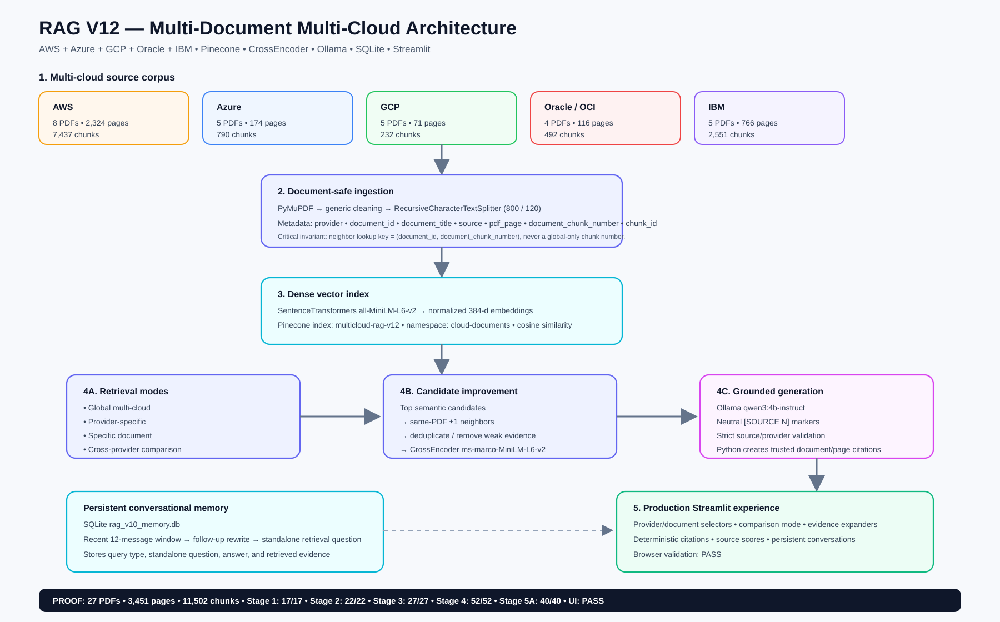

# RAG From Scratch — V12 Multi-Document Multi-Cloud RAG

This repository is a progressive, hands-on RAG engineering project built from first principles and evolved through multiple validated milestones.

The current milestone is **RAG V12: Multi-Document Multi-Cloud RAG**.

## Current V12 scope

V12 expands the system from a single private source document to a heterogeneous cloud corpus spanning:

| Provider | PDFs | Pages | Chunks |
| --- | ---: | ---: | ---: |
| AWS | 8 | 2,324 | 7,437 |
| Azure | 5 | 174 | 790 |
| GCP | 5 | 71 | 232 |
| Oracle | 4 | 116 | 492 |
| IBM | 5 | 766 | 2,551 |
| **Total** | **27** | **3,451** | **11,502** |

The source PDFs remain local and are intentionally excluded from Git.

## V12 architecture

  

~~~text
AWS / Azure / GCP / Oracle / IBM PDFs
                    ↓
                 PyMuPDF
                    ↓
              Text cleaning
                    ↓
Provider + document + PDF-page metadata
                    ↓
RecursiveCharacterTextSplitter
800 characters / 120 overlap
                    ↓
Document-safe chunk IDs
                    ↓
MiniLM normalized 384-d embeddings
                    ↓
Pinecone
multicloud-rag-v12 / cloud-documents
                    ↓
Global / provider / document / cross-provider retrieval
                    ↓
Same-PDF neighbor expansion ±1
                    ↓
Deduplication + low-information filtering
                    ↓
CrossEncoder reranking
                    ↓
Ollama qwen3:4b-instruct
                    ↓
Strict [SOURCE N] validation
                    ↓
Deterministic provider/document/PDF-page citations
                    ↓
SQLite persistent conversational memory
                    ↓
Streamlit production UI
~~~

## Production stack

- Python 3.12+
- uv
- LangChain Community document loaders
- LangChain text splitters
- PyMuPDF
- SentenceTransformers
- `sentence-transformers/all-MiniLM-L6-v2`
- Pinecone
- `cross-encoder/ms-marco-MiniLM-L6-v2`
- Ollama
- `qwen3:4b-instruct`
- SQLite
- Streamlit

## What V12 added

### Multi-document identity

Every chunk carries trusted metadata including:

~~~text
provider
document_id
document_title
source
pdf_page
document_chunk_number
global_chunk_number
chunk_id
~~~

### Document-safe neighbor expansion

Neighbors are keyed by:

~~~text
(document_id, document_chunk_number)
~~~

This prevents the final chunk of one PDF from expanding into a different PDF.

### Provider-aware retrieval

V12 supports:

- global multi-cloud retrieval;
- single-provider retrieval;
- specific-document retrieval;
- cross-document retrieval;
- cross-provider comparisons.

### Reranking

Pinecone performs dense semantic candidate retrieval. The CrossEncoder then reads the query and candidate text together and reranks the evidence before generation.

### Grounded deterministic citations

The LLM emits neutral markers such as:

~~~text
[SOURCE 2]
~~~

Python validates the marker and maps it to trusted metadata:

~~~text
[AWS | AWS Reliability Pillar | PDF page 9]
~~~

The model does not invent final provider/document/page citations.

### Persistent conversational memory

SQLite stores:

- conversations;
- user and assistant messages;
- query type;
- standalone rewritten follow-up question;
- retrieved evidence JSON.

Only the recent memory window is supplied to the LLM for conversational context.

### Production Streamlit UI

The UI supports:

- Auto routing;
- All Providers;
- Single Provider;
- Compare Providers;
- Specific Document;
- source/evidence inspection;
- deterministic citations;
- persistent conversations;
- rename, clear, and delete conversation controls.

## V12 measured proof

All PASS results below are observed runtime results.

~~~text
Stage 1 — Multi-document ingestion:              17/17 PASS
Stage 2 — Pinecone multi-document index:         22/22 PASS
Stage 3 — Retrieval + reranking:                  27/27 PASS
Stage 4 — Grounded answers + citations:           52/52 PASS
Stage 5A — Jupyter memory/UI backend validation:  40/40 PASS
Stage 5B — Streamlit browser validation:          PASS

RAG V12 — MULTI-DOCUMENT MULTI-CLOUD RAG: COMPLETE
~~~

Detailed proof:

- [V12 validation proof](docs/results/v12-validation.md)
- [V12 SQLite persistent-memory proof](docs/results/v12-sqlite-memory-proof.md)
- [V12 architecture, design decisions, and challenges](docs/v12-multi-document-rag.md)

## V12 engineering challenges

The V12 documentation records the major issues encountered and the resolutions, including:

1. scaling from one document to 27 heterogeneous PDFs;
2. preventing neighbor expansion across PDF boundaries;
3. the GCP Enterprise Foundations one-chunk parsing anomaly;
4. Jupyter/uv/Pinecone environment mismatch;
5. weak title-only Azure comparison evidence;
6. invalid `[SOURCE N]` values generated by the LLM;
7. enforcing provider coverage in comparisons;
8. rewriting follow-up questions such as “How does Azure compare with that?”;
9. keeping notebook-tested logic and production Streamlit code aligned.

See [docs/v12-multi-document-rag.md](docs/v12-multi-document-rag.md).

## V12 production files

~~~text
src/
├── rag_v12_pipeline.py
├── streamlit_app.py
├── memory_db.py
├── rag_v12_multidoc.py
└── rag_v12_multidoc_test.py

notebooks/
├── v12_multi_document_rag_stage1.ipynb
└── v12_multi_document_rag_stage2_pinecone.ipynb

docs/
├── rag-v12-multicloud-architecture.svg
├── v12-multi-document-rag.md
└── results/
    ├── v12-validation.md
    └── v12-sqlite-memory-proof.md

scripts/
└── v12_query_sqlite_memory.sql
~~~

## Run V12 locally

Clone and enter the repository:

~~~powershell
git clone https://github.com/kantinstephane10/kantinstephane10-rag-from-scratch-azure-aws.git
cd kantinstephane10-rag-from-scratch-azure-aws
~~~

Install dependencies:

~~~powershell
uv sync
~~~

Make sure Ollama has the required model:

~~~powershell
ollama list
~~~

Expected model:

~~~text
qwen3:4b-instruct
~~~

Set the Pinecone key locally:

~~~powershell
$env:PINECONE_API_KEY="YOUR_PINECONE_API_KEY"
~~~

Run Streamlit:

~~~powershell
uv run streamlit run src\streamlit_app.py
~~~

## SQLite proof query

The live SQLite database is local and intentionally not committed.

Query it with:

~~~powershell
sqlite3 data/memory/rag_v10_memory.db < scripts/v12_query_sqlite_memory.sql
~~~

The query displays:

- conversations;
- message counts;
- stored roles;
- query types;
- standalone questions;
- stored evidence counts;
- latest conversation turn summaries.

## Repository history

This project intentionally keeps its earlier milestones and baseline architecture for learning and comparison.

### Original RAG baseline

- [Original architecture](docs/rag-architecture.svg)
- [Original validation proof](docs/results/original-rag-validation.md)

### Later milestone artifacts

The repository also contains architecture and validation artifacts for V5.2 through V11, showing how the system evolved from local Chroma retrieval to query-aware retrieval, conversational memory, persistent SQLite memory, and Pinecone.

## Security

Do not commit:

- real Pinecone API keys;
- private source PDFs;
- SQLite conversation databases;
- local vector database directories.

The repository includes `.env.example` and `.gitignore` rules for local-only data.

## Current milestone

**RAG V12 — MULTI-DOCUMENT MULTI-CLOUD RAG: COMPLETE**

Next roadmap milestone: **V13 — Hybrid Search**.
