# RAG From Scratch — RAG V11

This branch contains **RAG V11: Pinecone Vector Database**.

## Branch

```text
feature/mba-rag-v11-pinecone-vector-db
```

V11 replaces the local ChromaDB vector store with **Pinecone** while preserving the validated V10 persistent-memory architecture and the validated V9 retrieval behavior.

---

## Architecture

<p align="center">
  
</p>

```text
Private Local PDF
      ↓
PyMuPDF + Cleaning
      ↓
Course/Page Metadata
      ↓
Recursive Chunking
      ↓
MiniLM Embeddings
      ↓
384-dimensional normalized vectors
      ↓
PINECONE
      ↓
Focused / Broad Retrieval
      ↓
Neighbor Expansion ±1
      ↓
CrossEncoder Reranking
      ↓
Ollama
      ↓
Deterministic Citations
      ↓
Streamlit
      ↓
SQLite Persistent Conversation Memory
```

---

## What changed in V11?

### V10

```text
MiniLM
  ↓
ChromaDB
  ↓
Neighbor Expansion
  ↓
CrossEncoder
```

### V11

```text
MiniLM
  ↓
Pinecone
  ↓
Neighbor Expansion
  ↓
CrossEncoder
```

Only the vector-database layer changed.

The following behavior remains preserved:

- PyMuPDF document loading;
- text cleaning;
- course/page metadata;
- recursive chunking;
- local MiniLM embeddings;
- focused vs. broad query routing;
- neighbor expansion;
- CrossEncoder reranking;
- course relevance filtering;
- Ollama generation;
- deterministic citations;
- grounded refusal;
- SQLite persistent conversational memory;
- multiple Streamlit conversations;
- rename, clear, delete, and restart persistence.

---

## Pinecone design

V11 keeps embeddings local.

Embedding model:

```text
sentence-transformers/all-MiniLM-L6-v2
```

Vector configuration:

```text
dimension = 384
metric = cosine
field = embedding
```

Default Pinecone configuration:

```text
index = mba-rag-v11
namespace = mba-portfolio
```

Each RAG chunk is stored in Pinecone with its vector and trusted retrieval metadata.

Example shape:

```python
{
    "_id": "mba_chunk_0000",
    "embedding": [...],
    "text": "...",
    "source": "...",
    "pdf_page": 10,
    "course": "C200",
    "chapter": "...",
    "rag_chunk_number": 0,
}
```

---

## Focused retrieval

```text
Question
   ↓
MiniLM Query Embedding
   ↓
Pinecone Top 8
   ↓
Neighbor Expansion ±1
   ↓
CrossEncoder
   ↓
Best 3
   ↓
Ollama
   ↓
Grounded Answer
```

---

## Broad retrieval

```text
Question
   ↓
MiniLM Query Embedding
   ↓
For each course:
    Pinecone metadata filter
    ↓
    Top 4
    ↓
    Neighbor Expansion ±1
    ↓
    CrossEncoder
    ↓
    Best 2
   ↓
Course Relevance Gate
   ↓
Ollama
   ↓
Grounded Answer
```

---

## Persistent conversation memory

V11 keeps the V10 SQLite memory layer.

```text
Streamlit
   ↓
SQLite
   ↓
Full Conversation History
   ↓
Recent 12 Messages
   ↓
LLM Context
```

The complete conversation is stored locally in SQLite, while only the most recent 12 messages are sent to the LLM.

---

## Observed initialization

```text
Pages loaded: 143
All chunks: 366
Course chunks: 354
Final indexed chunks: 351
Embedding shape: (351, 384)
Pinecone documents ready: 351
Index: mba-rag-v11
Namespace: mba-portfolio
```

---

## Validation

### Pinecone vector database

```powershell
uv run python src/rag_v11_pinecone_test.py
```

Observed:

```text
Tests passed: 14/14
Accuracy: 100.0%
V11 PINECONE VECTOR DATABASE: PASS
```

Validated:

- Pinecone authentication;
- index creation;
- dense-vector schema;
- 384 dimensions;
- cosine similarity;
- 351 stored documents;
- semantic search;
- metadata restoration;
- similarity scores;
- metadata filters;
- focused retrieval;
- C200 page 10 retrieval;
- CrossEncoder compatibility.

### RAG regression

```powershell
uv run python src/rag_v9_evaluation.py
```

Observed:

```text
Tests passed: 12/12
Accuracy: 100.0%
V9 REGRESSION TEST: PASS
```

This confirms Pinecone preserved the validated retrieval, reranking, follow-up rewriting, citations, broad-query filtering, and grounded-refusal behavior.

### SQLite memory regression

```powershell
uv run python src/rag_v10_memory_test.py
```

Observed:

```text
Tests passed: 18/18
Accuracy: 100.0%
V10 REPO MEMORY TEST: PASS
```

### Streamlit browser validation

Observed:

```text
PASS
```

Validated:

- Pinecone-backed focused retrieval;
- Pinecone-backed broad retrieval;
- persistent SQLite memory;
- new conversation;
- switch conversation;
- rename;
- clear;
- delete;
- restart persistence;
- deterministic citations;
- grounded refusal.

Full V11 details:

[docs/v11-pinecone-vector-db.md](docs/v11-pinecone-vector-db.md)

---

## Environment

Required:

```text
PINECONE_API_KEY
```

Optional:

```text
PINECONE_INDEX_NAME=mba-rag-v11
PINECONE_NAMESPACE=mba-portfolio
```

PowerShell example:

```powershell
$env:PINECONE_API_KEY="YOUR_REAL_PINECONE_API_KEY"
$env:PINECONE_INDEX_NAME="mba-rag-v11"
$env:PINECONE_NAMESPACE="mba-portfolio"
```

Never commit the real API key.

---

## Run V11

```powershell
git switch feature/mba-rag-v11-pinecone-vector-db
git pull origin feature/mba-rag-v11-pinecone-vector-db
uv sync
```

Run Pinecone validation:

```powershell
uv run python src/rag_v11_pinecone_test.py
```

Run RAG regression:

```powershell
uv run python src/rag_v9_evaluation.py
```

Run memory regression:

```powershell
uv run python src/rag_v10_memory_test.py
```

Run Streamlit:

```powershell
uv run streamlit run src/streamlit_app.py
```

---

## Private source document

The source PDF is intentionally **not stored in GitHub**.

The application expects the local file at:

```text
data/text_files/pdf/WGU_MBA_IT_Management_Bound_Edition_Biography_At_Beginning.pdf
```

The repository's `.gitignore` protects PDFs in this path from accidental commits.

---

## V11 milestone result

```text
Pinecone vector DB test:       14/14 PASS
V9 RAG regression:             12/12 PASS
V10 memory regression:         18/18 PASS
Streamlit browser validation:  PASS

RAG V11 — PINECONE VECTOR DATABASE: COMPLETE
```

---

## Next milestone

### V12 — Multi-Document RAG

V12 will extend the Pinecone-backed system from one private source document to multiple documents with document-aware metadata, filtering, retrieval, and citations.
