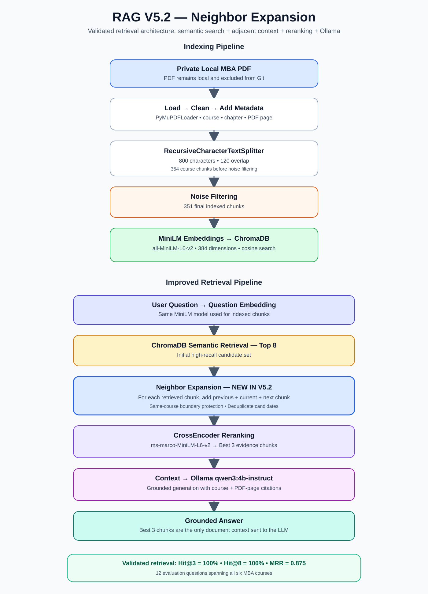

# RAG From Scratch — Working MBA RAG Branch

This branch contains the current working end-to-end RAG pipeline built during the learning project.

It uses a private local MBA portfolio PDF as the knowledge source, but **the PDF is intentionally not stored in this repository**.

## Branch

```text
feature/mba-rag-v5-2-neighbor-expansion
```

## Architecture Diagram



## Validation Proof

The strict 12-question retrieval evaluation is saved in [`docs/results/v5-2-validation.md`](docs/results/v5-2-validation.md).

Validated result: **Hit@3 = 100%**, **Hit@8 = 100%**, **MRR = 0.875**.

## Engineering Challenges, Decisions, and Why This Diagram

### Challenge — V4 retrieval was strong but not perfect

The strict evaluation tested 12 questions across all six MBA courses.

V4/V5.1 achieved:

```text
Hit@1: 66.7%
Hit@3: 91.7%
Hit@8: 91.7%
MRR:   0.792
```

Eleven questions passed, but this question failed:

```text
What technologies were proposed for the Agentic RAG architecture?
```

The correct answer existed in the PDF:

```text
Microsoft Foundry Agent Service
Azure AI Search
```

However, the answer-bearing chunk never reached the reranker.

### What the diagnostic showed

Semantic search retrieved an introductory chunk on the same section/page, but the exact technology names were in the **adjacent chunk**.

This distinction mattered:

```text
Semantic search found:
chunk 271

Answer was in:
chunk 272
```

A reranker cannot promote evidence that it never receives.

### Options considered

We could have:

- increased Top-K from 8 to a much larger number;
- changed the embedding model;
- changed chunk size and overlap;
- removed the reranker;
- added adjacent context around retrieved chunks.

### Decision — add neighbor expansion

We chose the smallest targeted change:

```text
semantic result
      ↓
previous chunk
current chunk
next chunk
      ↓
deduplicate
      ↓
CrossEncoder reranking
```

Neighbor expansion is restricted to the **same course** so retrieval does not accidentally cross course boundaries.

### Why we chose this instead of increasing Top-K blindly

The problem was not that the correct topic was far away semantically. The retriever had already found the correct section; the precise answer was simply split into the next chunk.

Neighbor expansion therefore adds **local context around a strong semantic hit** instead of flooding the reranker with many unrelated candidates.

### Result of the decision

After adding neighbor expansion:

```text
Hit@1:  75.0%
Hit@3: 100.0%
Hit@5: 100.0%
Hit@8: 100.0%
MRR:    0.875
```

The previously failed architecture question became:

```text
Rank 1
Source type: neighbor
PDF page: 115
Reranker score: 5.0393
```

### Why the V5.2 diagram is designed this way

The diagram intentionally adds a highlighted **Neighbor Expansion** box between ChromaDB retrieval and CrossEncoder reranking.

That location is important:

- ChromaDB first finds semantically relevant anchor chunks;
- neighbor expansion broadens the local evidence around those anchors;
- the CrossEncoder then decides which expanded candidates best answer the question;
- only the best three go to Ollama.

The diagram also includes the measured Hit@3 and MRR values because V5.2 was not just an architectural idea—the change was introduced to solve a measured retrieval failure and was validated with a regression test.

## Current Architecture

```text
Private Local PDF
       ↓
PyMuPDFLoader
       ↓
Text Cleaning
       ↓
Course / Chapter / Page Metadata
       ↓
RecursiveCharacterTextSplitter
800 characters / 120 overlap
       ↓
Front-Matter + Boilerplate Filtering
       ↓
Hugging Face MiniLM Embeddings
all-MiniLM-L6-v2
       ↓
ChromaDB
       ↓
User Question
       ↓
Question Embedding
       ↓
Top-8 Semantic Retrieval
       ↓
Neighbor Expansion (±1 chunk)
       ↓
CrossEncoder Reranking
ms-marco-MiniLM-L6-v2
       ↓
Best 3 Chunks
       ↓
Context Construction
       ↓
Ollama
qwen3:4b-instruct
       ↓
Grounded Answer
       ↓
Course + PDF Page Citation
```

## Privacy

The source PDF is private and must remain local.

The repository ignores:

```text
*.pdf
data/text_files/pdf/
chroma_db_*/
```

Do not commit personal PDFs or local ChromaDB files.

## Local PDF Location

Create this folder locally:

```text
data/
└── text_files/
    └── pdf/
```

Place the private PDF there using this filename:

```text
WGU_MBA_IT_Management_Bound_Edition_Biography_At_Beginning.pdf
```

The file will remain ignored by Git.

## Models

### Embeddings

```text
sentence-transformers/all-MiniLM-L6-v2
```

384-dimensional local embeddings.

### Reranker

```text
cross-encoder/ms-marco-MiniLM-L6-v2
```

The system retrieves eight candidates from ChromaDB and reranks them to the best three.

### Answer Generation

```text
qwen3:4b-instruct
```

The generation model runs locally through Ollama.

## Setup

Install Python 3.12+ and `uv`.

```powershell
git clone https://github.com/kantinstephane10/kantinstephane10-rag-from-scratch-azure-aws.git

cd kantinstephane10-rag-from-scratch-azure-aws

git switch feature/mba-rag-v5-2-neighbor-expansion

uv sync
```

Install Ollama separately, then pull the model:

```powershell
ollama pull qwen3:4b-instruct
```

Confirm it exists:

```powershell
ollama list
```

## Run

After placing the private PDF in the local ignored folder:

```powershell
uv run python src/rag_pipeline.py
```

The CLI will ask:

```text
Ask a question about the MBA document:
```

Example:

```text
What are my five CliftonStrengths?
```

A working answer should be grounded in the retrieved document and include a source citation such as:

```text
My five CliftonStrengths are Learner, Strategic, Belief,
Context, and Deliberative. [C200, PDF page 10]
```

## Current RAG Features

- PDF loading with PyMuPDF
- text cleaning
- recursive character chunking
- 800-character chunks
- 120-character overlap
- course/chapter/page metadata
- front-matter exclusion
- low-value boilerplate filtering
- local Hugging Face embeddings
- persistent ChromaDB vector storage
- semantic Top-K retrieval
- neighboring-chunk expansion
- CrossEncoder reranking
- local Ollama generation
- grounded prompting
- course and PDF-page citations

## Retrieval Evaluation

The V5.2 retriever was evaluated with 12 questions spanning all six MBA courses.

Results:

```text
Hit@1:  9/12  (75.0%)
Hit@3: 12/12 (100.0%)
Hit@5: 12/12 (100.0%)
Hit@8: 12/12 (100.0%)
MRR:   0.875
```

A retrieval failure involving the Agentic RAG architecture was diagnosed and fixed with neighboring-chunk expansion. The semantic search found an adjacent introductory chunk, and the answer-bearing next chunk was added before reranking.

## Next Step

The next milestone is **end-to-end answer evaluation with Ollama**: verify answer correctness, grounding, and source citations across all six MBA courses before adding a Streamlit interface or agent capabilities.
