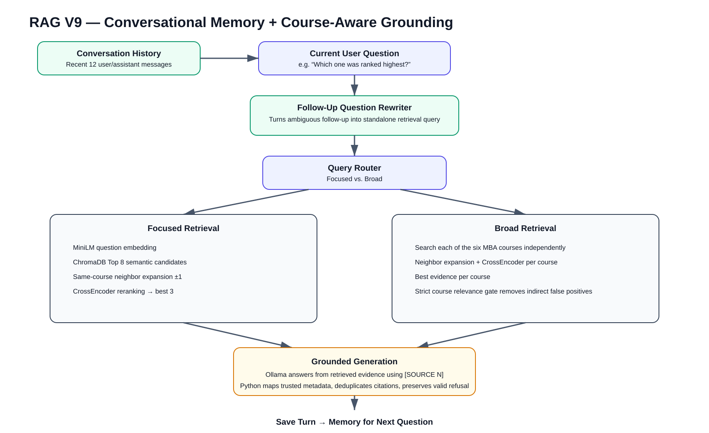

# RAG From Scratch — MBA RAG V9

This branch contains **RAG V9: Conversational Memory + Query-Aware Retrieval**.

## Branch

```text
feature/mba-rag-v9-conversational-memory
```

V9 is built directly on the validated V8 branch.

## What V9 adds

V9 turns the MBA RAG application from a single-question assistant into a conversational RAG system.

It adds:

- recent conversation history;
- follow-up question rewriting;
- standalone retrieval queries;
- focused vs. broad query routing;
- course-aware broad retrieval;
- strict course relevance filtering;
- deterministic citations from Python metadata;
- citation deduplication;
- grounded refusal protection.

## Architecture



## Conversational flow

```text
Conversation history
        +
Current question
        ↓
Follow-up question rewriter
        ↓
Standalone retrieval question
        ↓
Query router
       / \
Focused   Broad
   ↓        ↓
Top 8      Search all 6 courses
   ↓        ↓
Neighbor   Neighbor
   ↓        ↓
Rerank     Rerank
   ↓        ↓
Best 3     Course relevance gate
       \  /
        ↓
Retrieved evidence
        ↓
Ollama
        ↓
[SOURCE N]
        ↓
Python metadata citations
        ↓
Final grounded answer
        ↓
Save turn to session memory
```

## Conversation memory

V9 uses the most recent:

```text
12 messages
```

which is approximately six user/assistant turns.

Example:

```text
User:
What are my five CliftonStrengths?

Assistant:
Learner, Strategic, Belief, Context, and Deliberative.

User:
Which one was ranked highest?
```

V9 rewrites the follow-up internally as:

```text
Which of my five CliftonStrengths was ranked highest?
```

and retrieves fresh document evidence before answering.

Conversation history is used to **interpret** the question. It is not treated as a substitute for document evidence.

## Broad-query relevance gate

Searching every course solves portfolio coverage, but it can also surface weak indirect matches.

During Streamlit testing, C200 was initially treated as indirectly related to project management.

V9 therefore adds a strict evidence gate:

```text
search every course
→ rerank evidence
→ evaluate whether the course substantively discusses the topic
→ remove incidental/indirect matches
→ generate final answer
```

Final observed project-management result included only:

```text
MGT2-KKM1 — Project Management
```

## Models

- Embeddings: `sentence-transformers/all-MiniLM-L6-v2`
- Reranker: `cross-encoder/ms-marco-MiniLM-L6-v2`
- Generation: Ollama `qwen3:4b-instruct`

## Retrieval configuration

```text
chunk_size = 800
chunk_overlap = 120

focused semantic candidates = 8
neighbor range = ±1
focused final context = 3

broad semantic candidates/course = 4
broad final chunks/course = 2

conversation memory = 12 recent messages
```

## Validation

Observed conversational notebook result:

```text
Tests passed: 9/9
Accuracy: 100.0%
V9 CONVERSATIONAL MEMORY TEST: PASS
```

The Streamlit UI was also validated for:

- follow-up memory;
- standalone question rewriting;
- deterministic citations;
- broad project-management retrieval;
- removal of the C200 false positive;
- grounded stock-price refusal.

Full proof:

[docs/results/v9-validation.md](docs/results/v9-validation.md)

## Run the backend

```powershell
uv run python src/rag_pipeline.py
```

The CLI accepts multiple questions. Type:

```text
clear
```

to erase the current conversation or:

```text
exit
```

to quit.

## Run the regression evaluation

```powershell
uv run python src/rag_v9_evaluation.py
```

## Run Streamlit

```powershell
uv run streamlit run src/streamlit_app.py
```

## Memory scope

V9 memory is **session memory**.

It remembers recent conversation turns while the current Python / Streamlit session is active. It does not yet persist conversations across application restarts.

A future milestone can add persistent conversation storage with SQLite.

## Source document

The MBA portfolio PDF is expected at:

```text
data/text_files/pdf/WGU_MBA_IT_Management_Bound_Edition_Biography_At_Beginning.pdf
```
