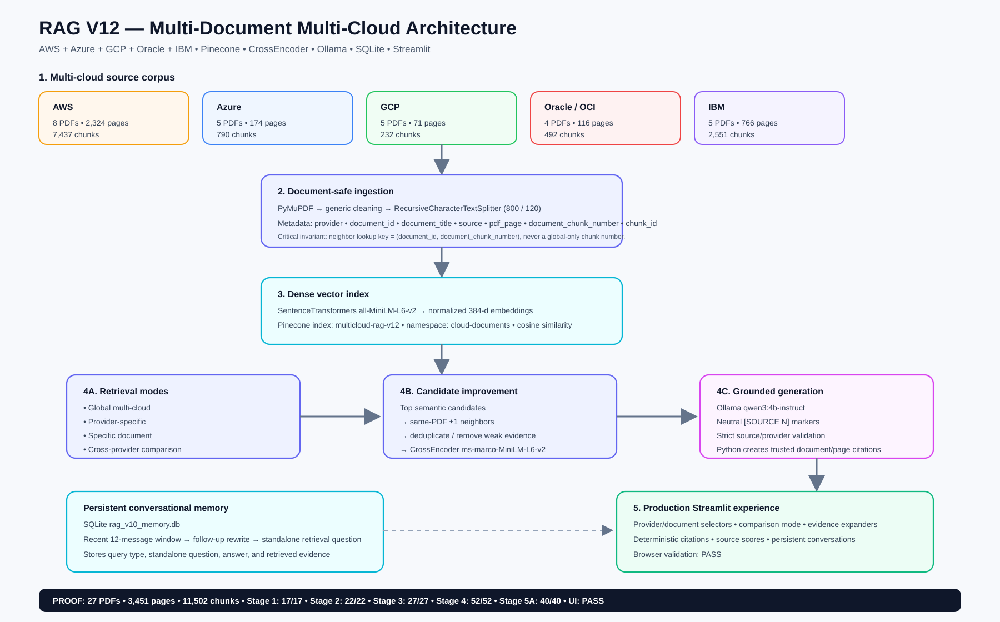

# RAG V12 — Multi-Document Multi-Cloud RAG

## Goal

Extend the validated V11 Pinecone RAG system from a single source PDF into a document-safe, multi-provider RAG application spanning AWS, Azure, GCP, Oracle, and IBM.

## Architecture

Dedicated validation evidence: [docs/results/v12-validation.md](results/v12-validation.md)

## Final corpus

| Provider | PDFs | Pages | Chunks |
| --- | ---: | ---: | ---: |
| AWS | 8 | 2,324 | 7,437 |
| Azure | 5 | 174 | 790 |
| GCP | 5 | 71 | 232 |
| Oracle | 4 | 116 | 492 |
| IBM | 5 | 766 | 2,551 |
| **Total** | **27** | **3,451** | **11,502** |

The heavy PDFs remain local and are excluded from Git by the repository PDF ignore rules.

## Architecture flow

~~~text
AWS / Azure / GCP / Oracle / IBM PDFs
                    ↓
                 PyMuPDF
                    ↓
              Text cleaning
                    ↓
Provider + document + PDF-page metadata
                    ↓
RecursiveCharacterTextSplitter (800 / 120)
                    ↓
Document-safe chunk IDs and neighbor lookup
                    ↓
MiniLM normalized 384-d embeddings
                    ↓
Pinecone: multicloud-rag-v12 / cloud-documents
                    ↓
Global / provider / document / cross-provider retrieval
                    ↓
Same-PDF neighbor expansion
                    ↓
Deduplication + weak-evidence filtering
                    ↓
CrossEncoder reranking
                    ↓
Ollama qwen3:4b-instruct
                    ↓
[SOURCE N] validation
                    ↓
Python deterministic provider/document/page citations
                    ↓
SQLite persistent conversational memory
                    ↓
Streamlit production UI
~~~

## Core design decisions

### 1. Document-safe neighbors

Neighbor expansion is keyed by:

~~~text
(document_id, document_chunk_number)
~~~

A single global chunk number is not sufficient in a multi-document corpus because the final chunk of one PDF must never pull the first chunk of another PDF.

### 2. Trusted citations are built in Python

The LLM emits neutral markers such as:

~~~text
[SOURCE 2]
~~~

Python maps those markers back to retrieved metadata and emits citations such as:

~~~text
[AWS | AWS Security Pillar | PDF page 8]
~~~

This prevents the LLM from inventing provider names, document titles, or page numbers.

### 3. Cross-provider retrieval is balanced

Comparison questions retrieve evidence separately for each requested provider. This prevents the provider with the larger corpus from dominating all candidates.

### 4. CrossEncoder reranking follows Pinecone retrieval

Pinecone performs fast dense semantic candidate retrieval. A CrossEncoder then reads the question and each candidate together and reorders the evidence before generation.

### 5. Existing SQLite memory is reused

V12 keeps the validated V10 persistent SQLite conversation model instead of creating a second memory system. Recent conversation history is used to rewrite follow-ups into standalone retrieval questions.

## Challenges encountered and how they were solved

### Challenge 1 — Scaling from one PDF to 27 heterogeneous PDFs

The corpus expanded to 27 PDFs, 3,451 pages, and 11,502 chunks with very uneven provider sizes. AWS alone contributed 7,437 chunks while GCP contributed 232.

**Resolution:** attach explicit provider and document identity to every page/chunk and preserve that metadata through Pinecone retrieval.

### Challenge 2 — Neighbor expansion could cross document boundaries

The previous single-document design could safely reason about adjacent chunk numbers. That assumption became unsafe with many PDFs.

**Resolution:** use the composite lookup key `(document_id, document_chunk_number)`. Stage 1 and Stage 3 explicitly validated that neighbor expansion never crosses a PDF boundary.

### Challenge 3 — One GCP source produced only one chunk

`GCP_Enterprise_Foundations_Blueprint.pdf` produced only one chunk, revealing a source-quality/parsing anomaly.

**Resolution:** keep the document represented rather than silently dropping it, record the anomaly, and rely on later retrieval validation to reveal whether it harms answers.

### Challenge 4 — Jupyter kernel and Pinecone dependency mismatch

The active notebook kernel used the workspace `.venv`, while the repository had its own environment. Standard `python -m pip` failed because the workspace environment was uv-managed and did not expose pip in the expected way.

**Resolution:** install into the exact Jupyter interpreter with `uv pip install --python <interpreter>`, then validate the Pinecone SDK in the notebook before continuing.

### Challenge 5 — Weak title-only evidence in cross-provider comparison

Early AWS/Azure comparison retrieval returned Azure chunks that contained little more than a document title. The LLM correctly refused because the evidence was not strong enough.

**Resolution:** increase provider-specific candidate retrieval, filter low-information chunks, and rerank each provider independently before combining comparison evidence.

### Challenge 6 — LLM could emit an invalid SOURCE number

A comparison could have four evidence blocks while the model emitted something such as `[SOURCE 5]`.

**Resolution:** tell the model the exact allowed source range, validate every SOURCE number in Python, and retry generation when invalid markers are detected.

### Challenge 7 — Cross-provider answers needed provider coverage validation

A syntactically valid answer could cite only AWS even when the user explicitly asked for AWS versus Azure.

**Resolution:** map cited SOURCE numbers back to provider metadata and require at least one cited evidence source from every requested provider.

### Challenge 8 — Follow-up questions were not standalone

A question such as "How does Azure compare with that?" cannot be retrieved correctly without conversation context.

**Resolution:** load the recent persistent SQLite history and rewrite the follow-up into a standalone question before retrieval.

### Challenge 9 — Production parity

Passing notebook code is insufficient if the repository Streamlit code is different.

**Resolution:** move the validated logic into `src/rag_v12_pipeline.py`, have `src/streamlit_app.py` import that backend, verify the committed files match the tested production files, then perform the browser test from repository code.

## Validation proof

See [V12 validation proof](results/v12-validation.md) for the complete measured evidence.

~~~text
Stage 1 — Multi-document ingestion:              17/17 PASS
Stage 2 — Pinecone multi-document index:         22/22 PASS
Stage 3 — Retrieval + reranking:                  27/27 PASS
Stage 4 — Grounded answers + citations:           52/52 PASS
Stage 5A — Jupyter memory/UI backend validation:  40/40 PASS
Stage 5B — Streamlit browser validation:          PASS
~~~

## Production files

- `src/rag_v12_pipeline.py` — V12 production backend
- `src/streamlit_app.py` — V12 production UI
- `src/memory_db.py` — persistent SQLite memory
- `docs/rag-v12-multicloud-architecture.svg` — architecture diagram
- `docs/results/v12-validation.md` — measured validation proof

## Final status

**RAG V12 — MULTI-DOCUMENT MULTI-CLOUD RAG: COMPLETE**
